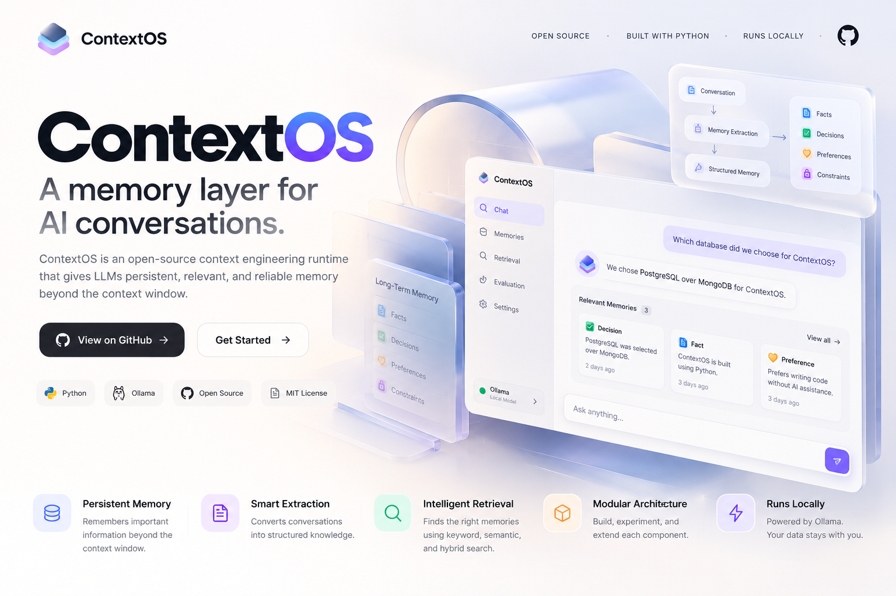

# ContextOS v0.1.0

## Product release

ContextOS is an open-source context engineering runtime that gives local LLM conversations persistent, relevant memory beyond the context window.

This first release establishes the foundation: local Ollama conversations, structured memory extraction, context-window management, and in-memory memory injection. We will build toward persistent storage, intelligent retrieval, evaluation, and production deployment.

---

Once we complete the retrieval layer, ContextOS will have its first working long-term memory system. But that is only the foundation.

For your goal of moving from 16 LPA toward 30–40 LPA AI engineering roles, I'd develop ContextOS into a production-grade context engineering runtime.

Here's the roadmap I would follow.

## ContextOS — Complete engineering roadmap

Phase 1 — Foundations

Mostly done

- CLI conversation with Ollama
- Token counting and context limits
- Sliding-window eviction
- Structured memory extraction
- In-memory memory store

Phase 2 — Memory retrieval

Current

- Keyword search and BM25
- Embeddings and cosine similarity
- Hybrid search and rank fusion
- Top-K retrieval
- Memory injection into LLM context

Phase 3 — Intelligent context management

- Dynamic token-budget allocation
- Memory relevance and importance scoring
- Recency and temporal validity
- Deduplication and memory consolidation
- Context compression and summarization

Phase 4 — Memory lifecycle management

- Persistent storage with PostgreSQL and pgvector
- Memory updates and invalidation
- Contradiction detection
- State transitions and historical decisions
- Memory provenance and source tracking

Phase 5 — Evaluation framework

- Build a benchmark dataset of conversations
- Measure retrieval Recall\@K and MRR
- Test long-range question answering
- Compare sliding window vs semantic vs hybrid memory
- Measure answer accuracy, token consumption, and latency

Phase 6 — Production systems engineering

- FastAPI service and API design
- Async extraction workers and queues
- Concurrency, retries, idempotency
- Observability with metrics and tracing
- Caching, load testing, and Docker deployment

Phase 7 — Advanced context engineering

- Hierarchical memory and episodic memory
- Entity relationships and graph-based retrieval
- Query-aware context planning
- Multi-agent memory isolation and sharing
- Prompt injection and memory poisoning defenses

## What you'll learn technically

| Area                  | Skills                                                   |
| --------------------- | -------------------------------------------------------- |
| Python engineering    | AsyncIO, concurrency, architecture, testing              |
| Information retrieval | BM25, embeddings, reranking, RRF                         |
| LLM engineering       | Tokenization, context construction, structured outputs   |
| Databases             | SQL, vector indexing, data modeling                      |
| Distributed systems   | Queues, workers, retries, consistency                    |
| Evaluation            | Benchmarks, statistical comparison, latency              |
| Security              | Tenant isolation, trust boundaries, injection resistance |

## The most important milestone for your career

I would place particular emphasis on Phase 5: Evaluation.

Many engineers can build an application that retrieves memories and sends them to an LLM.

Far fewer can demonstrate, with reproducible experiments, that their context-management approach improves results.

Imagine presenting these findings in an interview:

Example benchmark dashboard

Illustrative targets only — not actual ContextOS measurements

0%25%50%75%100%Sliding windowSemantic retrievalHybrid retrievalContextOS optimized

Hypothetical answer accuracy on a long-conversation benchmark

If you can substantiate results like these, explain the methodology, and defend the engineering trade-offs, the project becomes significantly more compelling than a typical RAG chatbot.

## How I would prioritize the work

## 1–2

Weeks

Working memory engine

Complete retrieval, context injection, and end-to-end tests.

## 3–4

Weeks

Intelligent memory management

Token budgeting, consolidation, updates, and contradiction handling.

## 5–6

Weeks

Evaluation and benchmarking

Build test datasets, establish baselines, and measure performance.

## 7–10

Weeks

Production engineering

Persistence, APIs, background workers, monitoring, and deployment.

Indicative timeline assuming consistent part-time work; actual progress will depend on implementation and debugging depth.

### My recommendation

Don't try to complete every advanced feature before applying for better roles.

Your first major target should be:

ContextOS v1 — A benchmarked, persistent memory runtime that demonstrably outperforms a sliding-window baseline on long-conversation tasks.

Then make it interview-ready with:

- A well-documented GitHub repository.
- Architecture diagrams explaining engineering decisions.
- Reproducible benchmarks and honest limitations.
- A technical write-up explaining the trade-offs you discovered.

This would give you a substantial project to discuss in AI platform, LLM infrastructure, and backend engineering interviews. It won't guarantee a 30–40 LPA offer, but it can strengthen your evidence of engineering depth.

For now, stay focused on Phase 2: Retrieval. We will continue implementing one component at a time, with you writing the code yourself.